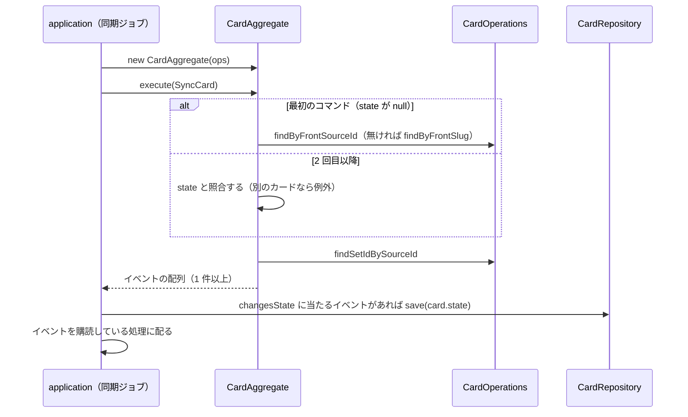

# カード集約

取得元（api.gatcg.com）のカードを取り込む Card 集約の設計。カードを書き換えるのは定期ジョブと手動起動の同期だけで、API は読むだけ。

## 集約の境界

| 集約    | 持つもの                                                   |
| ------- | ---------------------------------------------------------- |
| Card    | カード・面・裁定・参照・エディション・エディションの面     |
| CardSet | セット（複数のカードが共有し、ライフサイクルがカードと別） |
| Image   | 画像ファイル（カードの同期より後で取得してよい）           |

Card 集約のエンティティは `aggregates/card/entities/` に置く。ルートの `Card`（id で区別）、`CardEdition`（id で区別）、`CardFace` と `CardEditionFace`（親の中で表か裏かで区別）の 4 つ。面もエンティティにするのは、面ごとに変化を追い、エディションの面に画像を結び付けるため。集約の class は `CardAggregate`（`card-aggregate.ts`）で、エンティティの `Card` と名前を分ける。

エディションを Card に入れるのは、次の不変条件がカードとエディションをまたぐため。書き込むのは同期ジョブだけなので、集約を大きくしても更新は衝突しない。

- エディションの面の組（表だけ／表と裏）が、カードの面の組とそろう
- 既定のエディションは多くても 1 つ（既定のないカードが取得元に実在する）
- カードの面の組は、登録した後に変わらない（両面カードが片面になることも、片面カードに裏面が付くこともない）。変わったスナップショットは `CardSyncRejected` にする。取り下げて残すエディションの面の組も、これでカードの面の組とそろい続ける

## 集約の動かし方

集約は判断に要る操作（`CardOperations`）をコンストラクタで受け取り、必要になった分岐でだけ呼ぶ。状態は class が持ち、保存は application が明示的に行う。

- `execute` は何が起きたかを必ずイベントで返す。変更がなかったこと（`CardUnchanged`）と拒否したこと（`CardSyncRejected`）もイベントにする。この 2 つ以外のイベントは状態を変えたことを表し、application は保存する。
- 1 つの `CardAggregate` は 1 枚のカードだけを扱う。`SyncCard` はカードの id を持たないので、どのカードかは最初のコマンドの照合で決まる。決まった後のコマンドは DB ではなく `state` と照合し、別のカードに当たれば例外を投げる（application の使い方の誤り）。DB と照合すると、まだ保存していない登録や改訂を見落とすため。
- インスタンスは 1 回の同期の間より長く持たない。2 回目以降は DB を読み直さず、保存にも版の確認（楽観ロック）がないので、定期ジョブと手動の同期が同時に動くと、片方が古い `state` から上書きしてしまう。
- 保存するかどうかはイベントで決まるので、集約は読み込んだときの状態を持たない。repository はカードを upsert し、カードにない裁定・参照・面の行を消す。エディションの面の `image_id` は Image 側が書くので、更新する列に含めない。
- 主キーは保存の前に `newCardId` で決める。イベントに id を載せるため。DB の既定値（`uuidv7()`）には頼らないので、`IdGenerator` の実装も UUID v7 を返す。
- 「変更なし」の判定の前に、面・エディション・参照を決まった順に並べ直す。repository が返す順や取得元の順が変わっただけで保存しないため。裁定は並び順に意味があるので並べ替えない。

## コマンド

| コマンド       | 内容                                                                        |
| -------------- | --------------------------------------------------------------------------- |
| `SyncCard`     | 取得元のカード 1 枚分に合わせる。登録・改訂・変更なし・拒否は集約が判断する |
| `WithdrawCard` | 取得元から消えたカードに取り下げの印を付ける                                |

1 枚分の集約からは「取得元から消えた」が見えないので、どのカードを取り下げるかは `domain/services/select-cards-to-withdraw.ts` が決める。全ページを取り終えたときだけ選ぶ。途中で失敗した取得から判断すると、大量のカードを取り下げてしまう。

## 照合

カードもエディションも、表の面の sourceId で照合し、見つからなければ slug で照合する。取得元が id を振り直しても、同じカードとして改訂し、デッキからの参照を保つため。

slug で見つかったものの元の sourceId が今回の取得にも残っていれば、id の振り直しではないので、そのカードを拒否する。

## イベント

発行するイベントは domain が決める。購読する処理がまだないイベントもある。状態の変化はどれも、いずれかのイベントで表す。イベントのない変化が起きたら、集約の誤りとして例外を投げる。保存はイベントからではなく、repository が状態から行う。

| イベント                                         | 発行する条件                                                                                                                |
| ------------------------------------------------ | --------------------------------------------------------------------------------------------------------------------------- |
| `CardRegistered`                                 | 新しいカードを取り込んだ。全エディションの画像を取得する起点                                                                |
| `CardUnchanged`                                  | 同期した結果が今の状態と同じだった。取り下げ済みのカードをもう一度取り下げようとした                                        |
| `CardSyncRejected`                               | 取得元のデータが業務の規則に合わない。理由を持つ。状態は前回のまま                                                          |
| `CardCharacteristicsChanged`                     | 面のルールに関わる特性（名前・属性・class・type・subtype・コスト・level・life・power・durability・speed・効果文）が変わった |
| `CardFaceRevised`                                | 面のルールに関わらない値（sourceId・slug・effectRaw・取得元の更新日時）が変わった                                           |
| `CardRulingAdded`                                | 新しい裁定が出た。題に ERRATA を含むものは `isErrata: true`                                                                 |
| `CardRulingRemoved`                              | 裁定が取得元から消えた                                                                                                      |
| `CardRulingsReordered`                           | 前後の両方にある裁定の並び順が変わった。裁定の増減と同時に出ることもある                                                    |
| `CardReferencesChanged`                          | 参照が増えた・消えた                                                                                                        |
| `CardLegalityChanged`                            | 禁止・制限が変わった。変わったフォーマットだけを載せる                                                                      |
| `CardEditionAdded`                               | エディションが増えた。画像を初めて取得する起点                                                                              |
| `CardEditionRevised`                             | 既存のエディションの中身（セット・番号・レアリティ・既定かどうか・面の値）が変わった                                        |
| `CardEditionWithdrawn` / `CardEditionReinstated` | エディションが取得元から消えた／戻った                                                                                      |
| `CardWithdrawn` / `CardReinstated`               | カードを取り下げた／取り下げたカードが取得元に戻った                                                                        |

- 裁定は取得元が id を付けないので、題・日付・本文がすべて同じものを同じ裁定とみなす。文が直った裁定は、古い文の `CardRulingRemoved` と新しい文の `CardRulingAdded` になる。誤字の修正でも「新しい裁定」として知らせてしまうが、まれなので許容する。
- 絵の差し替えはイベントにしない。画像のパスはエディションの id で決まっていて、絵が変わってもパスは変わらない。Image 側が保存した ETag で取得元に問い合わせて検知する。

## 取得元から消えたもの

カードもエディションも行を消さず、取り下げた時刻を付けて残す。カードはデッキが参照し、エディションは将来コレクション機能が参照する。取得元にも残っていないデータは、消すと取り戻せない。

取り下げたエディションは既定にしない。

## 参照

参照先はカードの id に解決せず、取得元の slug のまま持つ。読む側が slug でカードを引き、見つからなければ未収録として扱う。

- 取得元には行き先のない参照が実在する（2026-11-28 時点で 5 件が `crystal-mastery` を指し、そのカードは取得元にない）。こちらでは書き換えない。公式が直したのか、こちらの書き換えが残っているだけなのかを区別できなくなるため。
- 未発売のカードを指す参照は、そのカードを取り込んだ時点で、何もしなくてもつながる。

## 規則違反と障害

| 起きたこと                              | 扱い                                                                                                             |
| --------------------------------------- | ---------------------------------------------------------------------------------------------------------------- |
| 取得元の応答の形が合わない              | infrastructure の zod で弾き、そのカードを飛ばしてジョブの結果で報告する                                         |
| 業務の規則に合わない                    | value object が `RuleViolation` を投げ、集約が `CardSyncRejected` に変える。前回の状態を残し、残りの同期は続ける |
| セットが同期されていない、DB の障害など | 例外のまま投げる（手順の誤りか障害で、業務の結果ではない）                                                       |

業務の規則は value object と集約に置き、zod には書かない。2 か所に書くとずれるため。

種別ごとの数値の規則（`card-characteristics.ts`）は、総合ルールに明記された「X は Y を持つ」の向きだけを置く（CHAMPION の level、ALLY と CHAMPION の life、ALLY・WEAPON・ATTACK の power、CHAMPION と REGALIA のメモリーコスト）。「Y を持つのは X だけ」の向きは、今のデータで成り立っても置かない。新しい種別のカードが出たときに拒否し続け、更新を止めるため。

属性・class・type は、総合ルールの一覧（[type-list](https://rules.gatcg.com/glossary/type-list)）にある値だけを受け付ける。type にはトークンを表すカードの TOKEN も入れる。新しい弾で一覧にない値が出ると、そのカードは `CardSyncRejected` になり、`element.ts`・`card-class.ts`・`card-type.ts` に足すまで取り込まれない。拒否の理由に値が載るので、ジョブの結果から気づける。subtype は 160 種を超え、弾ごとに増えるので一覧にしない。

取得元の表記の揺れは infrastructure で直してから集約に渡す。

- 裁定の日付に 0 で埋めていないもの（`2023-2-6`）がある。`YYYY-MM-DD` にそろえる。
- X コストは `cost.value` が `"X"`（`cost_memory` などは `-1`）。`"X"` で渡す。
- speed は真偽値で返る。`true` を `fast`、`false` を `slow` にする。
- 題のない裁定は空文字で返る。`null` にする。

## まだ反映していないもの

- `schema.ts` への反映：`cards` と `card_editions` に取り下げた時刻の列を足す。`card_references.to_card_id` を `to_slug` に変える。repository と一緒に行う。
- イベントを配る仕組み（同じプロセス内か outbox か）。
